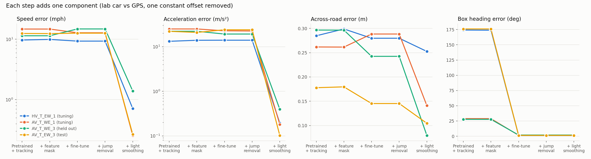
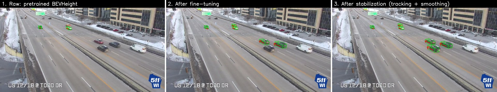
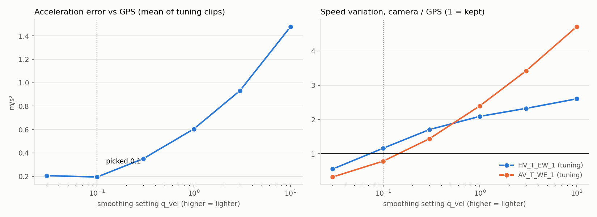
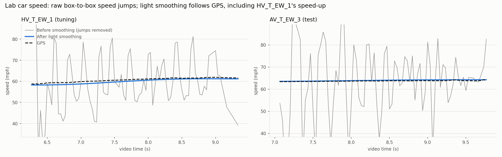
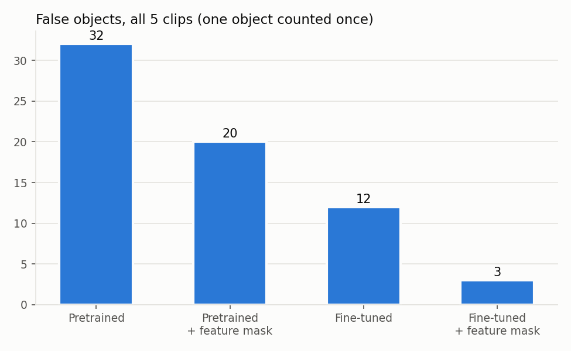

# Pipeline ablation: what each component adds (2026-10-11)

Roadside camera trajectory extraction with BEVHeight on the US 12/18 at Todd Drive
camera (WisDOT 511). Each component of the pipeline was added one at a time and
measured against the lab car's GPS, so that components with small gains can be
dropped. Code and results were reviewed with Codex before this write-up; its
corrections are folded in.

## Summary

| Component | What it does here | Keep? |
|---|---|---|
| Light smoothing (RTS, q_vel 0.1) | Nearly all of the trajectory accuracy: on the test clip speed error 12.6 to 0.27 mph, acceleration error 24 to 0.10 m/s², travel direction 2.7 to 0.3 deg, across-road 0.15 to 0.10 m | Yes |
| Fine-tune on stabilized boxes | Box heading 176 to 1.3 deg (boxes were backwards for cars driving toward the camera); lab car found in more frames (test 0.82 to 0.95, AV_T_WE_3 0.40 to 0.79). After smoothing the trajectory effect is mixed | Yes, for heading and detection |
| Feature mask (2.5 m) | False objects 32 to 20 (pretrained) and 12 to 3 (fine-tuned); negligible effect on the lab car's trajectory | Yes, for false detections |
| Jump removal | Before smoothing, states over 100 mph 126 to 105 across all vehicles; after smoothing none either way, and the lab car barely changes | Candidate to drop |





## Setup

**Steps.** S0 pretrained BEVHeight (102.4 m checkpoint) with the road filter and
tracking (AB3DMOT plus stitching). Positions are the raw detections assigned one
to one to the tracks and speed is the central difference between frames, so no
filter output is left in S0 to S3 (tracking still decides which boxes belong
together). S1 adds the feature mask at inference, S2 swaps in the head fine-tuned
on our stabilized boxes (same mask), S3 adds jump removal, S4 adds RTS smoothing.
Leave-one-out removes one component from S4. A reference row is the pipeline as it
was before (tracker output, old jump split, same smoothing).

**Jump removal** (the only new step, as Hang asked: smooth only the strange
results). A detection more than 4 robust sigmas (at least 0.4 m) off a straight
line through its neighbours within plus or minus 0.5 s, with two or more
neighbours on each side, is dropped; then a track is cut only where two remaining
detections are further apart than 100 mph allows over their real time gap.

**Clips and roles.**

| Clip | Role |
|---|---|
| HV_T_EW_1 | tuning (calibration, fine-tune labels, smoothing setting) |
| AV_T_WE_1 | tuning (calibration, fine-tune labels, smoothing setting) |
| AV_T_WE_3 | held out, partly: never trained or tuned on, but the mask height and road filter used all clips |
| AV_T_EW_3 | test |
| HV_T_EW_2 | false objects only (the lab car is inside a 3 s video hole) |

HV and AV are the same car in different driving modes. The 2.5 m mask height also
wins on the tuning clips alone (2 false objects against 4 for 4.5 m), and the road
filter is built from each clip's own traffic without GPS.

**Metrics** (fixed before running). Lab car against its GPS at the lab's timing,
with one constant offset removed (the timing and GPS mapping carry a systematic
error, so only the shape is compared). Across-road error (rms), speed error,
travel direction and box heading against the GPS heading, acceleration error over
plus or minus 0.25 s (windows across a gap are refused), speed variation ratio
(camera speed spread over GPS speed spread: 1 = kept, above 1 = noise, below 1 =
flattened), coverage (frames the car is observed, over the frames any step
observes it), and false objects per detector (one object counted once). Every
variant is scored on the frames all of them observe, so they share one car pass.

**Intervals.** Paired circular block bootstrap with 1 s blocks, 1000 samples, the
same samples for every variant, so the change between two steps has its own
interval. They cover variation within one pass only, not new sites or clips.
AV_T_WE_3 has too few common frames (26) for intervals.

**Smoothing setting.** Picked on the tuning clips only: mean acceleration error,
lightest setting within 10% of the best. The rule picked 0.1, the value the
pipeline already used. Lighter settings (0.3 and up) add noise instead of keeping
real variation; stronger smoothing (0.03) flattens HV_T_EW_1's real speed-up
(speed variation ratio 0.56).





## Results per clip

Brackets are 95% intervals. Before smoothing the acceleration error and speed
variation ratio measure box jitter, not real motion.

### Additive steps

| Clip | Role | Step | Frames | Coverage | Across (m) | Speed err (mph) | Travel dir (deg) | Box heading (deg) | Accel diff (m/s2) | Speed var ratio |
|---|---|---|---|---|---|---|---|---|---|---|
| HV_T_EW_1 | tuning | S0 pretrained + tracking | 75 | 0.85 | 0.28 [0.20, 0.35] | 9.72 [7.31, 12.19] | 3.84 [3.22, 4.56] | 174.2 [173.3, 175.0] | 13.22 [9.79, 16.58] | 14.94 [13.04, 31.02] |
| HV_T_EW_1 | tuning | S1 + feature mask | 75 | 0.84 | 0.30 [0.20, 0.38] | 9.95 [7.93, 12.02] | 4.19 [3.75, 4.76] | 174.0 [173.2, 174.5] | 13.95 [10.52, 17.06] | 15.35 [13.32, 33.04] |
| HV_T_EW_1 | tuning | S2 + fine-tune | 75 | 0.90 | 0.28 [0.19, 0.35] | 9.33 [7.77, 10.87] | 4.24 [3.52, 4.89] | 1.2 [1.1, 1.4] | 14.00 [11.02, 16.37] | 13.42 [11.36, 29.82] |
| HV_T_EW_1 | tuning | S3 + jump removal | 75 | 0.90 | 0.28 [0.19, 0.35] | 9.33 [7.77, 10.87] | 4.24 [3.52, 4.89] | 1.2 [1.1, 1.4] | 14.00 [11.02, 16.37] | 13.42 [11.36, 29.82] |
| HV_T_EW_1 | tuning | S4 + light smoothing | 75 | 1.00 | 0.25 [0.13, 0.34] | 0.71 [0.50, 0.90] | 0.65 [0.56, 0.73] | 1.2 [1.1, 1.4] | 0.19 [0.17, 0.22] | 1.22 [1.10, 1.39] |
| AV_T_WE_1 | tuning | S0 pretrained + tracking | 53 | 0.68 | 0.26 [0.21, 0.31] | 14.78 [11.60, 19.03] | 8.32 [6.85, 10.10] | 28.9 [21.9, 36.6] | 25.03 [19.31, 30.12] | 114.11 [99.05, 249.40] |
| AV_T_WE_1 | tuning | S1 + feature mask | 53 | 0.68 | 0.26 [0.21, 0.31] | 14.78 [11.59, 19.03] | 8.31 [6.85, 10.09] | 28.8 [21.9, 36.5] | 25.02 [19.30, 30.11] | 114.08 [99.02, 249.31] |
| AV_T_WE_1 | tuning | S2 + fine-tune | 53 | 0.87 | 0.29 [0.24, 0.33] | 12.82 [8.83, 17.90] | 10.45 [6.66, 15.08] | 1.5 [1.0, 2.1] | 22.76 [15.80, 29.62] | 96.79 [79.39, 245.28] |
| AV_T_WE_1 | tuning | S3 + jump removal | 53 | 0.84 | 0.29 [0.24, 0.33] | 12.81 [8.82, 17.90] | 10.36 [6.43, 15.08] | 1.5 [1.0, 2.1] | 22.51 [14.95, 29.62] | 96.54 [79.46, 245.28] |
| AV_T_WE_1 | tuning | S4 + light smoothing | 53 | 1.00 | 0.14 [0.08, 0.18] | 0.25 [0.16, 0.36] | 0.37 [0.29, 0.45] | 1.5 [1.0, 2.1] | 0.18 [0.11, 0.22] | 0.92 [0.59, 1.60] |
| AV_T_WE_3 | held out (partly) | S0 pretrained + tracking | 26 | 0.40 | 0.30 | 11.44 | 7.57 | 27.7 | 22.19 | 102.28 |
| AV_T_WE_3 | held out (partly) | S1 + feature mask | 26 | 0.40 | 0.30 | 11.44 | 7.56 | 27.7 | 22.20 | 102.27 |
| AV_T_WE_3 | held out (partly) | S2 + fine-tune | 26 | 0.79 | 0.24 | 14.84 | 6.30 | 1.9 | 19.24 | 121.31 |
| AV_T_WE_3 | held out (partly) | S3 + jump removal | 26 | 0.76 | 0.24 | 14.84 | 6.30 | 1.9 | 19.24 | 121.31 |
| AV_T_WE_3 | held out (partly) | S4 + light smoothing | 26 | 0.99 | 0.08 | 1.39 | 0.32 | 1.9 | 0.40 | 1.86 |
| AV_T_EW_3 | test | S0 pretrained + tracking | 66 | 0.82 | 0.18 [0.11, 0.24] | 12.49 [10.01, 14.62] | 3.10 [2.27, 4.08] | 176.0 [175.2, 176.7] | 22.15 [13.84, 28.99] | 87.92 [69.53, 198.09] |
| AV_T_EW_3 | test | S1 + feature mask | 66 | 0.83 | 0.18 [0.11, 0.24] | 12.42 [10.64, 14.43] | 3.17 [2.40, 4.08] | 176.0 [175.3, 176.6] | 20.91 [14.34, 27.82] | 86.97 [70.70, 187.17] |
| AV_T_EW_3 | test | S2 + fine-tune | 66 | 0.95 | 0.15 [0.10, 0.19] | 12.63 [9.03, 16.17] | 2.67 [2.30, 3.12] | 1.3 [1.0, 1.7] | 23.98 [14.44, 31.49] | 91.11 [70.13, 205.10] |
| AV_T_EW_3 | test | S3 + jump removal | 66 | 0.95 | 0.15 [0.10, 0.19] | 12.63 [9.03, 16.17] | 2.67 [2.30, 3.12] | 1.3 [1.0, 1.7] | 23.98 [14.44, 31.49] | 91.11 [70.13, 205.10] |
| AV_T_EW_3 | test | S4 + light smoothing | 66 | 1.00 | 0.10 [0.06, 0.14] | 0.27 [0.20, 0.34] | 0.30 [0.19, 0.42] | 1.3 [1.0, 1.7] | 0.10 [0.07, 0.13] | 1.30 [0.77, 1.85] |

Additive steps: change and 95% interval (negative = the first one is lower)

| Clip | Change | Across (m) | Speed err (mph) | Travel dir (deg) | Box heading (deg) | Accel diff (m/s2) | Speed var ratio |
|---|---|---|---|---|---|---|---|
| HV_T_EW_1 | S1 + feature mask minus S0 pretrained + tracking | 0.01 [-0.00, 0.03] | 0.23 [-0.23, 0.89] | 0.35 [0.08, 0.72] | -0.3 [-0.6, 0.1] | 0.72 [-0.09, 1.89] | 0.41 [-0.08, 4.22] |
| HV_T_EW_1 | S2 + fine-tune minus S1 + feature mask | -0.02 [-0.03, -0.00] | -0.62 [-1.47, 0.09] | 0.04 [-0.68, 0.58] | -172.7 [-173.3, -171.9] | 0.05 [-1.34, 1.87] | -1.93 [-3.90, -0.67] |
| HV_T_EW_1 | S3 + jump removal minus S2 + fine-tune | 0.00 [0.00, 0.00] | 0.00 [0.00, 0.00] | 0.00 [0.00, 0.00] | 0.0 [0.0, 0.0] | 0.00 [0.00, 0.00] | 0.00 [0.00, 0.00] |
| HV_T_EW_1 | S4 + light smoothing minus S3 + jump removal | -0.03 [-0.06, -0.00] | -8.62 [-10.05, -7.20] | -3.59 [-4.21, -2.87] | 0.0 [0.0, 0.0] | -13.80 [-16.20, -10.85] | -12.20 [-28.56, -10.19] |
| AV_T_WE_1 | S1 + feature mask minus S0 pretrained + tracking | -0.00 [-0.00, -0.00] | -0.00 [-0.01, -0.00] | -0.01 [-0.01, -0.00] | -0.0 [-0.1, 0.1] | -0.01 [-0.01, -0.00] | -0.03 [-0.08, -0.02] |
| AV_T_WE_1 | S2 + fine-tune minus S1 + feature mask | 0.03 [-0.04, 0.09] | -1.96 [-3.55, 0.01] | 2.14 [-1.04, 5.57] | -27.3 [-35.3, -20.3] | -2.27 [-5.58, 0.69] | -17.29 [-35.28, -3.88] |
| AV_T_WE_1 | S3 + jump removal minus S2 + fine-tune | 0.00 [0.00, 0.00] | -0.01 [-0.10, 0.00] | -0.09 [-0.18, 0.05] | 0.0 [0.0, 0.0] | -0.24 [-0.81, 0.00] | -0.25 [-0.60, 0.67] |
| AV_T_WE_1 | S4 + light smoothing minus S3 + jump removal | -0.15 [-0.20, -0.10] | -12.56 [-17.53, -8.65] | -9.99 [-14.71, -6.09] | 0.0 [0.0, 0.0] | -22.33 [-29.49, -14.79] | -95.62 [-243.84, -78.70] |
| AV_T_WE_3 | S1 + feature mask minus S0 pretrained + tracking | -0.00 | 0.00 | -0.01 | -0.0 | 0.00 | -0.01 |
| AV_T_WE_3 | S2 + fine-tune minus S1 + feature mask | -0.05 | 3.40 | -1.26 | -25.7 | -2.95 | 19.04 |
| AV_T_WE_3 | S3 + jump removal minus S2 + fine-tune | 0.00 | 0.00 | 0.00 | 0.0 | 0.00 | 0.00 |
| AV_T_WE_3 | S4 + light smoothing minus S3 + jump removal | -0.16 | -13.45 | -5.98 | 0.0 | -18.85 | -119.45 |
| AV_T_EW_3 | S1 + feature mask minus S0 pretrained + tracking | 0.00 [0.00, 0.00] | -0.07 [-0.87, 0.90] | 0.07 [-0.02, 0.17] | 0.0 [-0.1, 0.1] | -1.24 [-2.69, 0.82] | -0.95 [-12.85, 8.28] |
| AV_T_EW_3 | S2 + fine-tune minus S1 + feature mask | -0.03 [-0.06, -0.00] | 0.21 [-1.96, 2.02] | -0.50 [-1.48, 0.25] | -174.7 [-175.3, -173.9] | 3.07 [-1.15, 5.88] | 4.14 [-8.17, 21.19] |
| AV_T_EW_3 | S3 + jump removal minus S2 + fine-tune | 0.00 [0.00, 0.00] | 0.00 [0.00, 0.00] | 0.00 [0.00, 0.00] | 0.0 [0.0, 0.0] | 0.00 [0.00, 0.00] | 0.00 [0.00, 0.00] |
| AV_T_EW_3 | S4 + light smoothing minus S3 + jump removal | -0.04 [-0.06, -0.03] | -12.37 [-15.95, -8.71] | -2.37 [-2.76, -1.99] | 0.0 [0.0, 0.0] | -23.88 [-31.42, -14.32] | -89.82 [-203.20, -68.96] |

### Leave one out (from S4)

| Clip | Role | Step | Frames | Coverage | Across (m) | Speed err (mph) | Travel dir (deg) | Box heading (deg) | Accel diff (m/s2) | Speed var ratio |
|---|---|---|---|---|---|---|---|---|---|---|
| HV_T_EW_1 | tuning | S4 + light smoothing | 88 | 1.00 | 0.29 [0.15, 0.39] | 0.71 [0.51, 0.91] | 0.66 [0.55, 0.74] | 1.3 [1.1, 1.6] | 0.19 [0.17, 0.22] | 1.22 [1.10, 1.38] |
| HV_T_EW_1 | tuning | S4 without feature mask | 88 | 1.00 | 0.29 [0.15, 0.38] | 0.68 [0.57, 0.78] | 0.65 [0.53, 0.73] | 1.3 [1.1, 1.5] | 0.17 [0.15, 0.21] | 1.08 [0.97, 1.25] |
| HV_T_EW_1 | tuning | S4 without fine-tune | 88 | 0.95 | 0.30 [0.15, 0.40] | 0.33 [0.24, 0.42] | 0.67 [0.55, 0.76] | 174.1 [173.5, 174.7] | 0.17 [0.12, 0.23] | 1.03 [0.93, 1.20] |
| HV_T_EW_1 | tuning | S4 without jump removal | 88 | 1.00 | 0.29 [0.15, 0.39] | 0.71 [0.51, 0.91] | 0.66 [0.55, 0.74] | 1.3 [1.1, 1.6] | 0.19 [0.17, 0.22] | 1.22 [1.10, 1.38] |
| AV_T_WE_1 | tuning | S4 + light smoothing | 78 | 1.00 | 0.15 [0.08, 0.19] | 0.27 [0.17, 0.36] | 0.36 [0.28, 0.44] | 1.4 [1.1, 1.8] | 0.18 [0.10, 0.23] | 0.93 [0.59, 1.45] |
| AV_T_WE_1 | tuning | S4 without feature mask | 78 | 1.00 | 0.14 [0.08, 0.18] | 0.23 [0.15, 0.30] | 0.35 [0.29, 0.40] | 1.4 [1.1, 1.8] | 0.16 [0.09, 0.21] | 0.73 [0.42, 1.31] |
| AV_T_WE_1 | tuning | S4 without fine-tune | 78 | 0.94 | 0.13 [0.07, 0.17] | 0.32 [0.23, 0.42] | 0.34 [0.31, 0.37] | 24.6 [20.8, 28.7] | 0.10 [0.08, 0.12] | 0.56 [0.35, 0.85] |
| AV_T_WE_1 | tuning | S4 without jump removal | 78 | 1.00 | 0.14 [0.08, 0.18] | 0.25 [0.16, 0.33] | 0.35 [0.28, 0.42] | 1.4 [1.1, 1.8] | 0.17 [0.09, 0.22] | 0.82 [0.50, 1.40] |
| AV_T_WE_3 | held out (partly) | S4 + light smoothing | 59 | 0.96 | 0.09 [0.06, 0.12] | 1.30 [1.11, 1.50] | 0.32 [0.28, 0.37] | 1.8 [1.6, 2.1] | 0.40 [0.24, 0.57] | 1.67 [0.67, 2.68] |
| AV_T_WE_3 | held out (partly) | S4 without feature mask | 59 | 0.96 | 0.08 [0.05, 0.10] | 1.22 [1.03, 1.43] | 0.27 [0.24, 0.30] | 1.6 [1.3, 1.9] | 0.40 [0.27, 0.55] | 1.77 [0.75, 2.88] |
| AV_T_WE_3 | held out (partly) | S4 without fine-tune | 59 | 0.76 | 0.06 [0.04, 0.08] | 2.36 [2.27, 2.45] | 0.26 [0.24, 0.28] | 29.5 [8.5, 50.8] | 0.16 [0.13, 0.17] | 1.49 [1.11, 2.13] |
| AV_T_WE_3 | held out (partly) | S4 without jump removal | 59 | 0.96 | 0.09 [0.05, 0.11] | 1.29 [1.11, 1.49] | 0.30 [0.25, 0.35] | 1.8 [1.6, 2.1] | 0.39 [0.24, 0.55] | 1.65 [0.67, 2.67] |
| AV_T_EW_3 | test | S4 + light smoothing | 80 | 1.00 | 0.12 [0.07, 0.16] | 0.27 [0.19, 0.34] | 0.29 [0.17, 0.41] | 1.3 [1.0, 1.5] | 0.10 [0.07, 0.13] | 1.36 [0.92, 1.70] |
| AV_T_EW_3 | test | S4 without feature mask | 80 | 1.00 | 0.12 [0.07, 0.17] | 0.30 [0.24, 0.37] | 0.31 [0.20, 0.41] | 1.2 [1.0, 1.5] | 0.10 [0.06, 0.13] | 1.24 [0.76, 1.56] |
| AV_T_EW_3 | test | S4 without fine-tune | 80 | 0.98 | 0.16 [0.09, 0.21] | 0.17 [0.13, 0.21] | 0.40 [0.25, 0.56] | 176.2 [175.5, 176.7] | 0.09 [0.07, 0.12] | 0.74 [0.50, 0.98] |
| AV_T_EW_3 | test | S4 without jump removal | 80 | 1.00 | 0.12 [0.07, 0.16] | 0.27 [0.19, 0.34] | 0.29 [0.17, 0.41] | 1.3 [1.0, 1.5] | 0.10 [0.07, 0.13] | 1.36 [0.92, 1.70] |

Leave one out (from S4): change and 95% interval (negative = the first one is lower)

| Clip | Change | Across (m) | Speed err (mph) | Travel dir (deg) | Box heading (deg) | Accel diff (m/s2) | Speed var ratio |
|---|---|---|---|---|---|---|---|
| HV_T_EW_1 | S4 without feature mask minus S4 + light smoothing | -0.00 [-0.00, 0.00] | -0.03 [-0.13, 0.07] | -0.01 [-0.02, -0.00] | -0.0 [-0.1, 0.0] | -0.02 [-0.06, 0.02] | -0.14 [-0.16, -0.12] |
| HV_T_EW_1 | S4 without fine-tune minus S4 + light smoothing | 0.01 [0.01, 0.01] | -0.38 [-0.54, -0.24] | 0.02 [0.00, 0.03] | 172.8 [172.1, 173.5] | -0.03 [-0.09, 0.04] | -0.18 [-0.25, -0.08] |
| HV_T_EW_1 | S4 without jump removal minus S4 + light smoothing | 0.00 [0.00, 0.00] | 0.00 [0.00, 0.00] | 0.00 [0.00, 0.00] | 0.0 [0.0, 0.0] | 0.00 [0.00, 0.00] | 0.00 [0.00, 0.00] |
| AV_T_WE_1 | S4 without feature mask minus S4 + light smoothing | -0.01 [-0.01, -0.01] | -0.04 [-0.06, -0.01] | -0.01 [-0.04, 0.02] | 0.0 [-0.0, 0.0] | -0.02 [-0.04, -0.00] | -0.20 [-0.29, -0.00] |
| AV_T_WE_1 | S4 without fine-tune minus S4 + light smoothing | -0.02 [-0.02, -0.01] | 0.05 [-0.01, 0.12] | -0.02 [-0.08, 0.04] | 23.2 [19.1, 27.5] | -0.08 [-0.12, -0.01] | -0.37 [-0.97, 0.22] |
| AV_T_WE_1 | S4 without jump removal minus S4 + light smoothing | -0.01 [-0.01, -0.00] | -0.02 [-0.04, -0.00] | -0.01 [-0.03, 0.01] | -0.0 [-0.0, 0.0] | -0.01 [-0.02, 0.00] | -0.11 [-0.17, -0.00] |
| AV_T_WE_3 | S4 without feature mask minus S4 + light smoothing | -0.02 [-0.02, -0.01] | -0.08 [-0.11, -0.05] | -0.05 [-0.07, -0.03] | -0.2 [-0.5, 0.0] | -0.00 [-0.02, 0.03] | 0.10 [-0.07, 0.25] |
| AV_T_WE_3 | S4 without fine-tune minus S4 + light smoothing | -0.03 [-0.03, -0.02] | 1.06 [0.89, 1.23] | -0.06 [-0.12, 0.00] | 27.7 [6.5, 49.1] | -0.25 [-0.42, -0.09] | -0.19 [-1.12, 0.57] |
| AV_T_WE_3 | S4 without jump removal minus S4 + light smoothing | -0.01 [-0.01, -0.00] | -0.01 [-0.02, 0.00] | -0.02 [-0.03, -0.02] | 0.0 [0.0, 0.0] | -0.01 [-0.02, 0.00] | -0.02 [-0.10, 0.02] |
| AV_T_EW_3 | S4 without feature mask minus S4 + light smoothing | 0.01 [0.00, 0.01] | 0.04 [0.01, 0.06] | 0.01 [-0.00, 0.03] | -0.0 [-0.1, 0.0] | -0.00 [-0.01, 0.01] | -0.13 [-0.22, -0.03] |
| AV_T_EW_3 | S4 without fine-tune minus S4 + light smoothing | 0.04 [0.02, 0.06] | -0.10 [-0.19, 0.01] | 0.11 [0.07, 0.15] | 174.9 [174.2, 175.5] | -0.00 [-0.02, 0.03] | -0.62 [-0.86, -0.22] |
| AV_T_EW_3 | S4 without jump removal minus S4 + light smoothing | 0.00 [0.00, 0.00] | 0.00 [0.00, 0.00] | 0.00 [0.00, 0.00] | 0.0 [0.0, 0.0] | 0.00 [0.00, 0.00] | 0.00 [0.00, 0.00] |

### Reference

| Clip | Role | Step | Frames | Coverage | Across (m) | Speed err (mph) | Travel dir (deg) | Box heading (deg) | Accel diff (m/s2) | Speed var ratio |
|---|---|---|---|---|---|---|---|---|---|---|
| HV_T_EW_1 | tuning | S4 + light smoothing | 84 | 1.00 | 0.27 [0.15, 0.36] | 0.71 [0.50, 0.91] | 0.64 [0.55, 0.73] | 1.3 [1.1, 1.5] | 0.21 [0.17, 0.25] | 1.18 [1.05, 1.38] |
| HV_T_EW_1 | tuning | Previous pipeline (tracker output, q 0.1) | 84 | 0.90 | 0.28 [0.15, 0.36] | 0.71 [0.51, 0.89] | 0.65 [0.57, 0.74] | 0.8 [0.7, 1.0] | 0.21 [0.16, 0.24] | 1.16 [1.03, 1.35] |
| AV_T_WE_1 | tuning | S4 + light smoothing | 72 | 1.00 | 0.14 [0.08, 0.19] | 0.27 [0.17, 0.35] | 0.34 [0.24, 0.44] | 1.6 [1.1, 2.1] | 0.17 [0.11, 0.22] | 0.79 [0.46, 1.40] |
| AV_T_WE_1 | tuning | Previous pipeline (tracker output, q 0.1) | 72 | 0.87 | 0.13 [0.07, 0.16] | 0.19 [0.13, 0.24] | 0.31 [0.26, 0.36] | 1.2 [0.7, 1.8] | 0.13 [0.09, 0.16] | 0.47 [0.22, 0.88] |
| AV_T_WE_3 | held out (partly) | S4 + light smoothing | 62 | 1.00 | 0.09 [0.05, 0.13] | 1.08 [0.71, 1.46] | 0.29 [0.23, 0.35] | 2.6 [1.6, 3.6] | 0.41 [0.25, 0.54] | 1.55 [0.66, 2.92] |
| AV_T_WE_3 | held out (partly) | Previous pipeline (tracker output, q 0.1) | 62 | 0.79 | 0.07 [0.04, 0.10] | 1.06 [0.74, 1.39] | 0.24 [0.21, 0.27] | 2.3 [1.1, 3.6] | 0.39 [0.26, 0.49] | 1.34 [0.42, 2.65] |
| AV_T_EW_3 | test | S4 + light smoothing | 78 | 1.00 | 0.11 [0.07, 0.15] | 0.26 [0.19, 0.34] | 0.29 [0.16, 0.41] | 1.2 [1.0, 1.5] | 0.10 [0.07, 0.13] | 1.34 [0.94, 1.75] |
| AV_T_EW_3 | test | Previous pipeline (tracker output, q 0.1) | 78 | 0.95 | 0.12 [0.07, 0.16] | 0.31 [0.25, 0.37] | 0.31 [0.19, 0.42] | 0.9 [0.7, 1.2] | 0.10 [0.06, 0.14] | 1.19 [0.70, 1.53] |

Reference: change and 95% interval (negative = the first one is lower)

| Clip | Change | Across (m) | Speed err (mph) | Travel dir (deg) | Box heading (deg) | Accel diff (m/s2) | Speed var ratio |
|---|---|---|---|---|---|---|---|
| HV_T_EW_1 | Previous pipeline (tracker output, q 0.1) minus S4 + light smoothing | 0.00 [0.00, 0.01] | -0.01 [-0.02, 0.02] | 0.01 [0.00, 0.02] | -0.4 [-0.5, -0.4] | -0.01 [-0.01, -0.00] | -0.02 [-0.06, 0.01] |
| AV_T_WE_1 | Previous pipeline (tracker output, q 0.1) minus S4 + light smoothing | -0.02 [-0.02, -0.01] | -0.08 [-0.16, 0.01] | -0.03 [-0.09, 0.03] | -0.4 [-0.5, -0.3] | -0.05 [-0.07, -0.02] | -0.32 [-0.58, 0.22] |
| AV_T_WE_3 | Previous pipeline (tracker output, q 0.1) minus S4 + light smoothing | -0.02 [-0.03, -0.01] | -0.02 [-0.08, 0.04] | -0.05 [-0.08, -0.03] | -0.3 [-0.6, -0.0] | -0.02 [-0.06, 0.04] | -0.21 [-0.40, 0.19] |
| AV_T_EW_3 | Previous pipeline (tracker output, q 0.1) minus S4 + light smoothing | 0.01 [0.00, 0.01] | 0.04 [0.01, 0.07] | 0.02 [0.00, 0.03] | -0.3 [-0.4, -0.2] | -0.00 [-0.02, 0.01] | -0.15 [-0.28, -0.03] |

### False objects (all 5 clips, per detector)

| Detector | Objects | Boxes |
|---|---|---|
| base102_h151 | 32 | 3011 |
| basefeat25 | 20 | 866 |
| ft102feat25 | 3 | 13 |
| ft102 | 12 | 117 |

### Impossible states, all vehicles in all 5 clips (supplementary, added after the first results)

| Step | States | Over 100 mph | Share |
|---|---|---|---|
| S0 pretrained + tracking | 6677 | 97 | 1.45% |
| S1 + feature mask | 6668 | 101 | 1.51% |
| S2 + fine-tune | 7297 | 126 | 1.73% |
| S3 + jump removal | 7137 | 105 | 1.47% |
| S4 + light smoothing | 8637 | 0 | 0.00% |
| S4 without feature mask | 8632 | 0 | 0.00% |
| S4 without fine-tune | 8268 | 0 | 0.00% |
| S4 without jump removal | 8637 | 0 | 0.00% |
| Previous pipeline (tracker output, q 0.1) | 8570 | 0 | 0.00% |



## Reading the results

1. **Smoothing dominates.** On every clip it brings speed error under 1.4 mph and
   acceleration error to 0.1 to 0.4 m/s². The intervals of the change exclude zero
   for speed and acceleration on all clips with intervals, and for across-road
   error too (just barely on HV_T_EW_1).
2. **Fine-tuning** is what makes the boxes face the right way, and it finds the
   lab car in more frames. After smoothing it does not consistently improve the
   trajectory: speed error is lower without it on HV_T_EW_1 (0.33 against 0.71
   mph) and the test clip (0.17 against 0.27), and much higher without it on
   AV_T_WE_3 (2.36 against 1.30). Across-road error changes by a few cm either way.
3. **The feature mask** changes the lab car's trajectory by about 1 cm at most;
   its value is the false objects.
4. **Jump removal** has no effect once smoothing is on.
5. **The pipeline as it was before** (reference rows: tracker output, old jump
   split) is within a few hundredths of a metre and mph of S4, with 0.3 to 0.4 deg
   lower box heading error, but it observes the lab car in fewer frames (0.79 to
   0.95 against 1.00): its old jump split cut tracks where the tracker held a box
   still for a few missed frames.

## Past experiments, briefly

| When | What | Result |
|---|---|---|
| Aug | First self-training runs on our own stabilized boxes | Labelling only clean tracks made the model unlearn other cars; training all six classes collapsed features; train cars only and label every detected car |
| Sep 30 | Pilot fine-tune (heading from motion) | Box heading error 7.9 to 1.7 deg, but boxes 0.68 m below the road |
| Sep 30 | Height fix (box centre, not bottom) | Boxes on the road; off-road boxes 361 to 206 |
| Oct 1 | Corrected labels (each track fitted to the car's outline) = ft102 | Boxes sit on the cars; the model used since |
| Oct 1 | 140.8 m range checkpoint | Lost the far range (few labels far away); not used |
| Oct 3 | Real frame timestamps instead of frame / 30 | AV_T_WE_3 speed ratio 0.959 to 0.992, frozen frames no longer read as stops |
| Oct 3 | Smoothing strength sweep | q_vel 0.1, the strongest that keeps HV_T_EW_1's real speed-up (confirmed again here) |
| Oct 3-6 | GPS benchmark and its independent check | Lateral and heading are timing-free; along-road needs absolute timing we do not have |
| Oct 7 | Input mask vs feature mask (Bofeng's idea) | Input mask cuts the text overlay in half and adds false boxes; feature mask 12 to 3 false objects |
| Oct 7 | Fine-tunes with masks and with GPS labels | Feature-mask fine-tune 2 false objects; GPS-only labels did not transfer to the test clip (one car per clip); GPS plus other cars raised false boxes because "no car" was only taught near the GPS car |

## Caveats

- One test pass (66 to 80 common frames) and one site. The intervals are within
  that pass; more independent clips, ideally from other sites, are needed for
  general claims.
- The tuning clips set the calibration, labels and smoothing, so their numbers
  are optimistic; the test clip is the honest one.
- The lab timing and the GPS mapping have a systematic error; removing one
  constant offset hides any part of it that is constant, by design.

## Reproduce

```
python scripts/evaluation/ablation.py run --variants q_sweep
python scripts/evaluation/ablation.py pick-q
python scripts/evaluation/ablation.py run --variants main --q 0.1
python scripts/evaluation/ablation.py score
python scripts/reporting/ablation_figures.py
```
Detections for the pretrained and pretrained plus mask runs come from
`run_bevheight_generic.py` with the 102.4 m checkpoint (`--feat-mask` with the
2.5 m mask for the latter).
